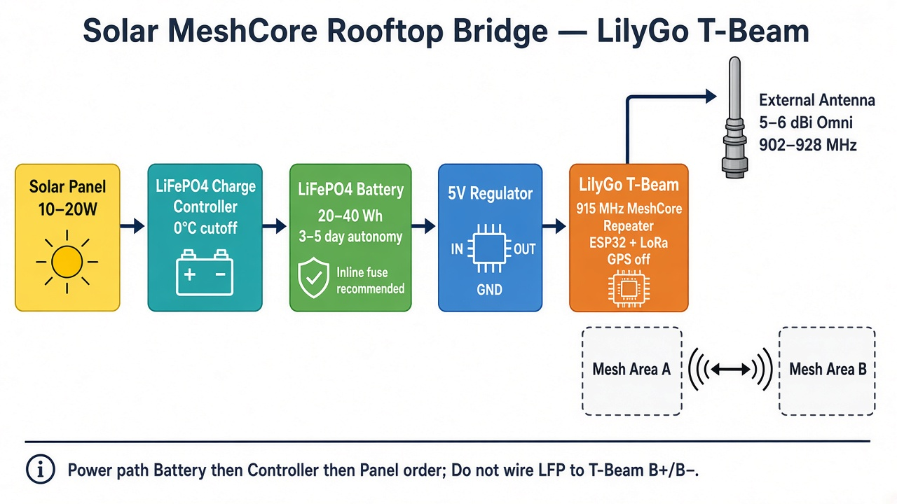

# Solar MeshCore Repeater

Solar-powered **MeshCore** rooftop bridge repeater design for **US/CA (902–928 MHz)**, built around a **LilyGo T-Beam**.

| Spec | Value |
|------|--------|
| Role | Rooftop bridge |
| Autonomy | 3–5+ days |
| Access | Serviceable rooftop |
| Radio | LilyGo T-Beam 915 MHz |
| Firmware | MeshCore **Repeater** |

## Architecture

**Power path:** Solar panel → LiFePO4 charge controller → LiFePO4 battery → 5 V regulator → T-Beam USB/5V  

Do **not** connect LiFePO4 to the T-Beam `B+`/`B−` pads — the onboard AXP charger targets ~4.2 V (Li-ion) and can overcharge LFP.

## Bill of materials

See [BOM.md](BOM.md) for a priced parts list (~**$228** recommended build, Oct 2026 retail estimates).

## Flash & configure

1. Identify T-Beam revision (v1.1 AXP192 vs v1.2/Supreme AXP2101) and LoRa chip (SX1262 vs SX1276).
2. Flash **Repeater** firmware: [flasher.meshcore.io](https://flasher.meshcore.io)
3. Configure radio to match your local mesh (US/CA often `910.525,62.5,7,5` — confirm with your group).
4. Disable GPS for fixed rooftop use; keep flood advert interval long.
5. Bench-test ≥72 h with the panel covered before install.

## Safety

- Fuse the battery positive lead close to the pack.
- Attach the antenna before any transmit.
- Use a charge controller with **0 °C charge cutoff** in freezing climates.
- Seal outdoor RF and cable entries; mount glands facing down.

## License

Documentation and diagrams in this repository are provided as-is for community reuse. Hardware trademarks (LilyGo, etc.) belong to their owners.
